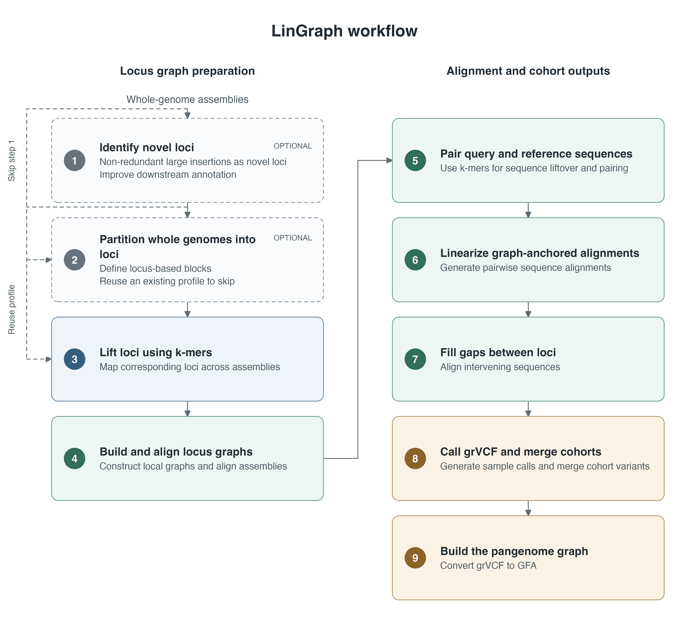

# LinGraph

LinGraph is a variants-guided **pangenome graph builder** and an
**assembly-based structural variant caller**. It records variant sequences and
assembly coordinates in **grVCF (Graph Recursive VCF)** to preserve assembly
sequence information losslessly, and can export merged cohort calls as a
pangenome graph with per-haplotype paths.

The main purpose of grVCF is lossless representation of assembly sequences.
Its recursive representation also makes shared variants unambiguous: every
carrier of a row shares the same sequence change at the same parent-relative
coordinates. Differences between carriers are represented by additional rows,
including **variants on insertions**. Reconstruction checks cover the assembly
regions represented by the calls; coverage reports identify regions that are
not represented.

| Your goal | Command | Starting point |
| --- | --- | --- |
| Call variants in new assemblies | `individual` | Prepared haplotypes and an existing LinGraph graph, such as Win50KGraph |
| Build a graph and call a cohort | `graph` | Prepared cohort assemblies and a reference |
| Soft-mask, rename, and index FASTAs | `prepare` | Raw assembly FASTAs |

## Getting started

**Start with the worked examples in [demo/](demo/).** They include data
downloads, preparation, complete commands, and validation steps. Choose the
example closest to your task:

| Demo | What it covers |
| --- | --- |
| [HG002 on CHM13](demo/HG002_CHM13/README.md) | Individual calling with Win50KGraph, benchmarking, and reusing alignments |
| [HG002 on HG19](demo/HG002_HG19/README.md) | Preparing another reference and building its reference cache |
| [NA19240 trio SV calling](demo/NA19240trio_SVcall/README.md) | Calling a trio with the precomputed graph |
| [NA19240 trio graph](demo/NA19240trio_graph/README.md) | Building a cohort graph, exporting GFA/GAF, and checking the results |

The commands below are a shorter route through the current workflow. Run them
from the LinGraph repository root, and replace `/data/...` paths with your own.
Each demo states its own working-directory layout.

- [Install](#installation-and-requirements)
- [Prepare assemblies](#prepare-assembly-fastas)
- [Quick start A: individual calling](#quick-start-a-call-variants-in-your-assemblies)
- [Quick start B: cohort graph](#quick-start-b-build-a-cohort-pangenome-graph)
- [Reference selection and reuse](#choose-or-change-the-reference-backbone)
- [Outputs and large singleton insertions](#output-files)
- [grVCF and standard VCF conversion](#grvcf-format-and-standard-vcf-conversion)
- [GFA and GAF export](#build-a-pangenome-gfa-from-grvcf)
- [SLURM and restarting](#running-on-slurm-resuming-and-recovering)
- [Validation and benchmarking](#validation-and-benchmarking)

## Installation and requirements

You need Python **3.9 or later**, Conda, `make`, and a C++17-capable compiler.
LinGraph uses Unix command-line tools and runs locally or on SLURM.

```bash
git clone https://github.com/Walfred-MA/LinGraph.git
cd LinGraph
python3 install.py --conda-env lingraph -j 8
conda activate lingraph
python install.py --check-only
```

If you already have the repository, start from its root. Activate the
`lingraph` environment in each new shell and use its `python` interpreter for
subsequent commands; submitted SLURM stages inherit it.

The installer installs dependencies, builds the native tools under
`scripts/src/`, and places executables in `scripts/` or `tools/` as appropriate.
Run it again after updating native source code.

| Dependency | Purpose |
| --- | --- |
| Snakemake **6.15.1**, tabulate **0.8.10** | Workflow execution with pinned versions |
| HTSlib **≥1.19**, samtools | Indexed sequence access |
| BLAST+ **≥2.14.0**, including WindowMasker | Alignment and repeat masking |
| sdust | Faster, optional low-complexity masking |
| minimap2, Winnowmap2, meryl | Mapping and k-mer processing |
| bcftools | VCF processing |
| numpy, polars ≥1.0, mappy, parasail, edlib, ssw-py | Analysis and alignment libraries |

Use `--check-only` to check runtime dependencies, or `--no-install-deps` to
build against an environment you manage yourself. Advanced installation and
helper-path settings are covered in the [command guide](scripts/LinGraph.md).

Graph construction requires at least **4 CPUs**. For a cohort run, plan for
**32 CPUs and at least 64 GB RAM**, with additional memory and temporary space
for larger cohorts. Preparation examples below use **16 threads**.

## Prepare assembly FASTAs

Each haplotype must be an **uncompressed, soft-masked FASTA with an adjacent
`.fai` index**. Query contigs use the prefix **`SAMPLE#N#`**, which makes contig
names unique across assemblies. For example, `HG002_h1` corresponds to
`HG002#1#chr1`.

### 1. List the raw assemblies

Create `raw_assemblies.list` with one haplotype per row, two columns, and no
header:

```text
HG002_h1 /data/raw/HG002.h1.fasta.gz
HG002_h2 /data/raw/HG002.h2.fasta.gz
```

Haplotype names must be unique. Relative FASTA paths are resolved from the
list's directory, and paths cannot contain whitespace.

### 2. Prepare with 16 threads

```bash
python scripts/LinGraph.py prepare \
  -q raw_assemblies.list -O prepared_assemblies \
  --contignamefix -t 16
```

This writes prepared copies and indexes, plus the input list for subsequent
calling: **`prepared_assemblies/query_paths.prepared.txt`**. The source FASTAs
are preserved. The same options work with `python tools/prepare_assemblies.py`.

**Most preparation time is spent repeat masking with WindowMasker, which can
be slow for whole genomes.** Without `-j`, `-t 16` is a total CPU budget shared
across assemblies: two haplotypes are prepared concurrently with about eight
masking processes each. Existing soft masking is retained unless you pass
`--remask`.

### Faster masking with sdust

You can try **sdust** by adding `--masker sdust`. It is much faster than
WindowMasker, but masks low-complexity sequence while leaving transposons
unmasked. **Using sdust reduces trio consistency by about 0.3–0.6
percentage points compared with WindowMasker**, due to the unmasked
transposons. WindowMasker remains the default; use it when trio consistency
is the priority.

```bash
python scripts/LinGraph.py prepare \
  -q raw_assemblies.list -O prepared_sdust \
  --contignamefix --masker sdust -t 16
```

To compare maskers on already soft-masked inputs, also pass `--remask` and
use a separate output folder. Selecting `--masker sdust` alone does not
replace existing masking.

| Option | Effect |
| --- | --- |
| `-q LIST` | Prepare every assembly in a list |
| `-i FASTA --name HG002_h1` | Prepare one haplotype |
| `--contignamefix` | Add the expected contig prefix where it is missing |
| `--remask` | Regenerate masking, including on already masked inputs |
| `--masker windowmasker` / `--masker sdust` | Select the masker; WindowMasker is the default |
| `-t 16` | Share a 16-CPU budget across inputs when `-j` is omitted |
| `-j JOBS -t THREADS` | Prepare JOBS assemblies at once with THREADS masking processes each, using about JOBS × THREADS CPUs |

`CHM13_h1` and `HG38_h1` keep native reference contig names; index their
uncompressed FASTAs with `samtools faidx`. Other references follow the prefix
rules. Do not nest haplotype prefixes or reuse a name for different assemblies.

Calling checks preparation before starting. `--force-prepare` can make
prepared copies under `OUTPUT/PreparedAssemblies/`, which are removed after a
successful run. For a cohort, prepare once beforehand so later runs can reuse
the same files. See the [assembly-preparation guide](tools/assembly_preparation.md)
for name-only fixes, masking details, and additional options.

## Quick start A: call variants in your assemblies

Use `individual` to call each haplotype against an existing LinGraph graph.
The [HG002 on CHM13 demo](demo/HG002_CHM13/README.md) provides the complete
example, including reference download and benchmarking.

### 1. Download Win50KGraph

Win50KGraph is a precomputed graph summary built with balanced blocks for
individual SV calling. The archive is about 2.43 GB; allow additional space
for extraction and reconstruction.

```bash
curl -L -C - https://ndownloader.figshare.com/files/69451449 -o Win50KGraph.tar.gz
tar -xzf Win50KGraph.tar.gz
```

The package record is [Figshare: Win50KGraph](https://doi.org/10.6084/m9.figshare.33930604).
It contains local graph definitions, packed alternative sequences, and
reference caches for CHM13 and GRCh38.

### 2. Reconstruct the local graphs once

Use the CHM13 FASTA matching the package, with its `.fai` index:

```bash
python scripts/reconstruct_local_graph_folders.py \
  -i cohort_minsetref_v3/summary \
  -r /data/references/chm13.fa --reference-haplotype CHM13_h1 \
  -o Win50KGraph -j 16 --resume
```

Keep the extracted `cohort_minsetref_v3/` directory: `Win50KGraph/` links to
its summary and reference caches. Reuse the reconstructed graph for later
samples. Reconstruction always uses the package's CHM13 reference, even if
subsequent calls use another reference.

### 3. Call the prepared haplotypes

```bash
python scripts/LinGraph.py individual \
  -I prepared_assemblies/query_paths.prepared.txt \
  -G Win50KGraph \
  -r /data/references/chm13.fa --reference-name CHM13_h1 \
  --reference-caches Win50KGraph/references/CHM13_h1_rig \
  -O HG002_calls -t 16
```

Each haplotype gets its own grVCF and coverage reports under
`HG002_calls/samples/NAME/`. For example:
`HG002_calls/samples/HG002_h1/HG002_h1.vcf`.

To call one FASTA, replace `-I ...` with
`-i /data/prepared/HG002_h1.fa --sample HG002_h1`. With several inputs, add
`--merge` to also publish merged cohort files. The individual calling workflow
merges these calls in CIGAR mode; use the [exact merge](#merge-existing-grvcfs)
when you need shared-row identity for graph interpretation.

## Quick start B: build a cohort pangenome graph

Use `graph` to build local graphs, call the cohort, and merge its variants.
Add `--make-graph` to also export the GFA and per-haplotype GAFs. Follow the
[NA19240 trio graph demo](demo/NA19240trio_graph/README.md) for a complete
worked example.

### 1. Create the cohort list

List the reference and every prepared haplotype in `cohort.list`:

```text
CHM13_h1 /data/references/chm13.fa
HG002_h1 /data/prepared/HG002_h1.fa
HG002_h2 /data/prepared/HG002_h2.fa
HG003_h1 /data/prepared/HG003_h1.fa
HG003_h2 /data/prepared/HG003_h2.fa
```

Use the actual paths from `prepared_assemblies/query_paths.prepared.txt`.
Keep the reference first and select it explicitly with `-r CHM13_h1`.

### 2. Build, call, merge, and export

```bash
python scripts/LinGraph.py graph \
  -I cohort.list -G cohort_graph -O cohort_calls \
  -b windowprofs/geneblocks.bed --bed-grouped \
  -r CHM13_h1 --alternative data/alternatives.fa \
  --exact --make-graph -t 32
```

| Option | Meaning |
| --- | --- |
| `-G cohort_graph` | Saved local graphs and construction inputs |
| `-O cohort_calls` | Calling, merge, and graph-export outputs |
| `-b ... --bed-grouped` | Use the supplied block profile |
| `--alternative data/alternatives.fa` | Add the recommended alternative-sequence catalog for CHM13 |
| `--exact` | Recursive merge using indexed assemblies; this is the graph workflow's default |
| `--make-graph` | Export `cohort.gfa` and `gaf/SAMPLE.gaf` after merging |

Keep `-G` and `-O` **separate, non-nested directories**. Omit `--make-graph`
to stop after the VCFs; you can export later with `--gfa-only`. Repeat the
same command to resume an interrupted run.

### Blocks and alternative sequences

The supplied block profiles use CHM13 coordinates:

| Profile | Use |
| --- | --- |
| `windowprofs/geneblocks.bed` | Recommended for graph building and gene-based downstream analysis |
| `windowprofs/balanceblocks.bed` | Optimized for local alignment and SV calling; used by Win50KGraph |

Use either with `--bed-grouped`. Without a BED, LinGraph chooses blocks from
the inputs. Optional novel-locus discovery is controlled by
`--find-novel-loci`; `--static-block` keeps the initial block templates fixed.

For a new species with only one reference, use `blockindex` followed by
`graph --construct-only --static-block`. See the
[two-step single-reference guide](docs/blockindex.md) for commands and outputs.

The bundled [data/alternatives.fa](data/alternatives.fa) complements CHM13 and
is recommended when constructing a CHM13 graph. Keep the same catalog when
resuming. Its `.fai` is included; regenerate the index if you change the FASTA.
The catalog supplements the reference FASTA and its row in `cohort.list`.

## Choose or change the reference (backbone)

`-r` accepts a saved haplotype name or an external FASTA path. For an external
reference, use `--reference-name NAME_h1` when needed. Keep a separate calling
output directory for each reference.

For a completed cohort graph, reuse the graph and choose a different saved
haplotype as the calling reference and exported backbone:

```bash
python scripts/LinGraph.py graph \
  -G cohort_graph -O cohort_calls_HG003_h1 \
  -r HG003_h1 --exact --make-graph -t 32
```

Saved graph alignments are reused, and the reference-dependent steps run
again. Use a normal `graph` run for a new reference; `--recall-only` keeps the
existing calling reference. An existing graph-mode output can recover its
reference from `inputs/cohort_call.run.json` when `-r` is omitted. For a new
run, the default is the first saved cohort assembly. Set `-r` explicitly when
you want a particular exported backbone.

For individual calling, reuse an earlier output's graph alignments with
`--reuse-alignments PREVIOUS_OUTPUT`. See the
[HG002 CHM13 demo](demo/HG002_CHM13/README.md) for switching references.

### Reference caches

A reference cache stores the reference's alignment to the local graphs.
Win50KGraph supplies caches for `CHM13_h1` and `HG38_h1`. To use GRCh38, supply
its FASTA, `--reference-name HG38_h1`, and the matching cache
`Win50KGraph/references/HG38_h1_rig`.

Build a cache for another prepared reference with:

```bash
python scripts/LinGraph.py individual \
  -G Win50KGraph \
  -r /data/references/HG19.prepared.fa --reference-name HG19_h1 \
  --reference-only -O HG19_cache -t 16
```

This writes a reusable cache under `GRAPH/references/` and calls no samples.
The [HG19 demo](demo/HG002_HG19/README.md) covers reference preparation.

Automatic cache selection checks the reference name, alignment mode, and a
fingerprint of contig names and lengths. The fingerprint does not compare
sequence contents. An explicit `--reference-caches DIR` uses that cache
without validation, so supply one that matches the reference.

## Output files

| Path under `OUT/` | Contents |
| --- | --- |
| `samples/NAME/NAME.vcf` | Per-haplotype grVCF |
| `samples/NAME/NAME.coverage.summary.tsv` | Individual-call coverage summary |
| `samples/NAME/NAME.coverage.missing_reference.bed`, `NAME.coverage.missing_query.bed` | Uncovered intervals from individual calling |
| `cohort.sv.vcf`, `cohort.indel.vcf`, `cohort.snp.vcf` | Merged calls, according to the selected merge mode |
| `cohort.sv.10Ksingleton.vcf` | Large singleton insertions separated from the main SV file by default |
| `cohort.samples.headers.gz` | Per-sample coverage and mapping headers retained during merging |
| `cohort.gfa` | Exported pangenome graph in rGFA format |
| `gaf/SAMPLE.gaf`, `gaf/gaf_stats.tsv` | Per-haplotype walks and their summary |
| `gaf/SAMPLE.gaf.breaks.tsv` | Reasons for breaks in a sample's walks |
| `checkpoints/local_reference_templates.fa`, `checkpoints/alternative_loci.fa` | Reference-specific templates and alternative loci for cohort calling |
| `lingraph/` | Run records, logs, and checkpoints |

Individual mode writes reference-specific template and alternative-locus
FASTAs under each `samples/NAME/` directory. Preserve the original grVCFs,
mapping headers, and matching reference/catalog FASTAs for reconstruction,
conversion, and graph export.

### Large singleton insertions

By default, merging writes insertions **at least 10,000 bp long with `NSUP=1`**
to `cohort.sv.10Ksingleton.vcf`, instead of `cohort.sv.vcf`. One supporting
haplotype defines a singleton here. The main SV file and singleton file
together retain the full published SV merge.

The graph uses the main cohort VCFs and excludes these singleton insertions.
LinGraph passes the singleton file to the exporter so each affected GAF walk
ends before the excluded query interval and resumes afterward. These breaks
are marked `excluded_row` in the sample's breaks table.

Set `--large-singleton-size BP` during merging to change the threshold, or
`--large-singleton-size 0` to retain all such insertions in the main SV file
and subsequent graph. For a custom threshold, combine `--merge-only` and
`--make-graph` in the same command so merging and export share the setting.
**Include the singleton VCF when splitting a complete merge or checking its
losslessness.**

## grVCF format and standard VCF conversion

grVCF uses the usual VCF columns plus sequence, assembly-coordinate, and
mapping annotations. LinGraph writes grVCFs with the `.vcf` extension. The
format is designed to preserve assembly sequence information and can encode
graph topology through nested variants.

### CIGAR and recursive representations

| Representation | How it preserves an observation | Meaning of a shared row |
| --- | --- | --- |
| **CIGAR** (`##graphvcfmergeVersion=cigar`) | Per-observation sequence alignment, size, breakpoint offset, and assembly coordinates | Carriers can differ from the displayed representative in sequence and placement |
| **Recursive / exact** (`##graphvcfmergeVersion=exact`) | Shared operations plus nested, flank, separated, and SNP rows that preserve remaining differences | All carriers share that row's sequence change and parent-relative coordinates |

The recursive model preserves bases while making row-level comparisons
unambiguous. A carrier's **complete allele** includes the parent operation and
its carried child rows, so complete alleles can differ even when their parent
row is shared. Indexed assemblies and reference FASTAs are used by the exact
merge to resolve placements and sequence differences.

### Variants on insertions

Suppose Insertion A adds `ACGTTGCA` at a reference position. Child B is a
**nested variant on Insertion A**, adding `GG` after A's fourth base:

| Haplotype | Carried rows | Complete inserted sequence |
| --- | --- | --- |
| h1 | A | `ACGTTGCA` |
| h2 | A and B | `ACGTGGTGCA` |

B's `CHROM` is A's row ID, so B's coordinates refer to A's sequence.
Additional SNPs, deletions, or insertions can be represented on A, and further
variants can be nested on B. Each row retains one coordinate system; child
coordinates are interpreted on the parent before sibling edits are applied.

### Fields to preserve

| Field | Meaning |
| --- | --- |
| `CHROM`, `POS`, `ID` | Parent sequence, position, and row identity; nested rows name their parent ID in `CHROM` |
| `INFO/SVTYPE`, `END`, `SVLEN`, `SEQ` | Representative operation, interval, size, and sequence |
| `INFO/EXTENDGRAPHCIGAR` | Representative sequence/alignment encoding, including graph targets |
| `FORMAT/GT` | Haploid state: `1` supports the variant, `0` is callable reference, `.` is missing |
| `FORMAT/TYPE`, `SIZE`, `EXTENDGRAPHCIGAR` | Per-observation event, size, and alignment |
| `FORMAT/ASSEMBLYCONTIG`, `QUERYCOORD` | Assembly contig and zero-based query coordinate or range, with strand |
| `FORMAT/TEMPLATEOFFSET` | Observation breakpoint displacement from the representative's position |
| `FORMAT/BASE`, `ALLELENAME`, `LABEL_H` | SNP base and optional provenance |

Multiple observations in a sample use corresponding comma-separated entries;
they are not additional genotype copies. Read each record's FORMAT column,
as optional fields can vary.

SNP positions are one-based. Symbolic root events use boundary coordinates
such as `[POS, END)`, with `END=POS` for a pure insertion. Nested positions
are interpreted on the parent allele; nested insertion offsets use `POS-1`.
Some records can have `POS=0`. Preserve IDs and use LinGraph's tools to resolve
these conventions and graph-encoded sequences. The
[grVCF guide](docs/LinGraph_Graph_Recursive_VCF.pdf) explains the format in detail.

### Merge existing grVCFs

Use a list with one per-sample VCF path per line. The standalone merge tool
uses CIGAR mode by default:

```bash
python tools/merge_grvcfs.py -I vcfs.list -O merged_cigar -t 16
```

For recursive / exact output, also provide the assembly list and reference:

```bash
python tools/merge_grvcfs.py -I vcfs.list -O merged_exact -t 16 \
  --exact prepared_assemblies/query_paths.prepared.txt \
  --reference-fasta /data/references/chm13.fa
```

Repeat `--reference-fasta` for any local reference templates and alternative
loci required by the calls. Graph-mode calling selects exact merging by
default. Explicit `--all`, `--svonly`, `--svindel`, or `--snp` select CIGAR
merge categories instead. The default SV/indel size boundary is **20 bp**;
use `--svcutoff 50` when you need a 50-bp boundary.

To add samples to an existing cohort, call them against the same graph and
reference, split the existing merge with `tools/convert_merged_grvcf.py split`,
and merge the resulting per-sample files with the new calls. Supply all
categories and the singleton VCF, if present, when splitting. Keep
`cohort.samples.headers.gz` alongside the merge to retain per-sample coverage.
See the [merge and conversion tools](tools/README.md).

### Convert to standard VCF

```bash
python tools/grvcf_to_vcf.py \
  -i cohort_calls/cohort.sv.vcf \
  -o cohort_calls/cohort.sv.standard.vcf
```

Repeat for other categories and the singleton file when those calls are needed.
The streaming converter removes nested rows and `POS=0` records, keeps GT and
a small INFO subset, and converts symbolic insertions with a plain `SEQ` to
explicit REF/ALT bases. Graph-encoded insertion sequences remain symbolic.
It does not normalize, sort, or validate alleles against a reference.

This export represents the displayed alleles; it drops information needed
for lossless reconstruction and graph building. Keep the original grVCFs.
Plain and gzip inputs are supported; `.vcf.gz` output requires `bgzip` and is
not indexed automatically. See the [converter guide](tools/README.md#convert-grvcf-to-standard-vcf).

### Reference contig names

CHM13 calls use RefSeq accessions (`NC_060925.1` … `NC_060948.1`); GRCh38 uses
`chr1` … `chrY`. Other assemblies use their `NAME#N#` prefix. To produce copies
with plain chromosome names:

```bash
python tools/vcf_chromfix.py \
  -i cohort_calls/cohort.sv.vcf -o cohort_calls/cohort.sv.chr.vcf --CHM13fix
# For another reference, remove its prefix:
python tools/vcf_chromfix.py -i calls.vcf -o calls.chr.vcf --noprefix
```

Keep the original names for LinGraph processing so they match the FASTAs.
Nested rows retain their parent references during renaming.

## Build a pangenome GFA from grVCF

To export a finished cohort's merged calls without recalling or re-merging:

```bash
python scripts/LinGraph.py graph \
  -G cohort_graph -O cohort_calls -r CHM13_h1 --gfa-only -t 16
```

**`--gfa-only` generates both the GFA and per-sample GAFs.** It selects only
the export stage. The current C++ exporter, `GrvcfGraph`, writes
`cohort_calls/cohort.gfa`, `cohort_calls/gaf/SAMPLE.gaf`, and summary/debug
tables. Links needed by sample walks are included in the exported GFA.

Export reads the merged grVCFs, reference, templates, sequence catalogs, and
sample mapping headers. It obtains sequence bases from those files without
rereading the assemblies. Keep the matching FASTAs and their `.fai` indexes
available. Use all variant categories from the exact merge for a complete
graph; the C++ export does not support `--svonly` or `--insertion-only`.

- `--gaf-threads N` controls how many samples are walked concurrently
  (default: `-t`); reduce it to lower memory use.
- `--max-node-length N` sets the maximum segment length (default: 1,024 bp).
- An explicit `-r` selects the backbone. Without it, export uses the saved
  combined reference/alternative/novel catalog.
- Large singleton insertions follow the [merge policy above](#large-singleton-insertions).

The output is **rGFA**, with sequence-origin and offset tags (`SN`, `SO`) on
segments. Variants define branches and links, and GAF records describe each
haplotype's walks. A GAF can contain multiple records for a contig when part
of that contig is excluded or cannot be represented by a valid walk.

For direct input selection and the Python conversion workflow, see
[merged grVCF to GFA](scripts/merged_vcf_to_gfa.md). Standard-VCF exports lack
the annotations needed for graph construction.

## Running on SLURM, resuming, and recovering

Activate the Conda environment, then add the cluster options to your command:

```bash
python scripts/LinGraph.py graph \
  -I cohort.list -G cohort_graph -O cohort_calls \
  -b windowprofs/geneblocks.bed --bed-grouped \
  -r CHM13_h1 --alternative data/alternatives.fa \
  --exact --make-graph -t 32 \
  --slurm --slurm-jobs 20 \
  --slurm-account ACCOUNT --slurm-partition PARTITION
```

Individual mode submits one job per haplotype. Full graph runs submit workflow
stages separately; partial runs such as `--gfa-only` use one allocation.
`--slurm-jobs` defaults to 20. Additional `sbatch` arguments can be supplied
through `--slurm-args`.

### Memory defaults

The cohort thresholds below count **input sample VCFs**, typically one per
haplotype, rather than diploid individuals.

| Job | Default memory | Override |
| --- | --- | --- |
| Individual calling or its merge allocation | 64G | `--slurm-memory` |
| Cohort matching, lifting, graph CIGAR, gap filling, VCF calling | 32G per job | `--match-memory`, `--genomelift-memory`, `--graphcigar-memory`, `--gapfill-memory`, `--vcf-memory` |
| Cohort extraction and local templates | 64G | `--extraction-memory` |
| Cohort merge scans, concats, and publish | 64G below 100 sample VCFs; 128G from 100 onward | `--slurm-memory` for run-once stages; `--merge-memory` for merge defaults |
| Cohort SV chromosome merge | **32G below 100 sample VCFs; 64G from 100 onward; chr1 doubled** | `--merge-memory` |
| Cohort small-variant chromosome merge | 64G below 100 sample VCFs; at least 128G from 100 onward, scaling with cohort size | Automatically sized by the workflow |
| GFA export | 64G | `--slurm-memory` |
| Novel-locus discovery | 128G | `--novel-slurm-memory` |

For an out-of-memory failure, inspect `sacct -j JOBID` and the run's SLURM
logs, increase the relevant memory setting, and repeat the command. See
`--help-all` for additional per-stage controls.

### Resume or rerun a stage

Repeating the same command reuses finished work. To select a later stage:

| Task | Option |
| --- | --- |
| Export existing merged calls to GFA and GAF | `--gfa-only` |
| Re-merge saved per-haplotype calls | `--merge-only` |
| Recall VCFs from saved gap-filled alignments and merge them | `--recall-only` |
| Export after re-merging or recalling | Also add `--make-graph` |
| Validate inputs and print planned commands | `--dry-run` |

After a killed run, clear stale workflow locks only once its jobs have exited:

```bash
python scripts/LinGraph.py --unlock cohort_graph cohort_calls
```

This keeps checkpoints and outputs. See the
[cohort workflow guide](scripts/cohort_call_snakemake/README.md) for recovery
details and the [graph-building guide](scripts/graph_build_snakemake/README.md)
for construction options.

## Workflow overview



LinGraph divides the genome into blocks, builds and aligns local graphs, and
projects the resulting calls onto the chosen reference and alternative loci.
The merged grVCFs retain variant sequences and assembly coordinates. Recursive
variant relationships then define the topology of the exported pangenome graph.

`individual` reuses existing local graphs; `graph` constructs or resumes them
from the cohort. Reference-specific alternative sequences are saved with each
calling run, and packed graph sequences live in `GRAPH/summary/alternatives.fasta`.
Overlapping source blocks can remain separate alternative loci, each with its
own contig name.

[Download the workflow figure (PDF)](figures/lingraph_workflow.pdf).

## Validation and benchmarking

Lossless reconstruction, graph-walk validation, and trio consistency measure
different properties:

| Check | Tool or guide |
| --- | --- |
| Reconstruct represented assembly regions from a per-sample grVCF | `tools/check_vcf_lossless.py` |
| Check merged sequence reconstruction and shared-row identity | `tools/check_merge_lossless.py` |
| Compare per-haplotype variant totals in merged VCFs and GAF walks | `tools/compare_vcf_gaf_stats.py` |
| Check whether child variants are supported by either parent | [QuickTriocheck](benchmark/QuickTriocheck.README.md) or [Truvari trio benchmark](benchmark/truvari_trio.README.md) |
| Inspect SLURM time by pipeline step | `tools/slurm_step_times.py` |

Use the [trio graph demo](demo/NA19240trio_graph/README.md) for validation
commands, and the [benchmark guide](benchmark/README.md) for trio runs. Calls
compared within a trio must use the same reference; preserve coverage headers
so uncallable regions can be handled correctly.

For full merged reconstruction, include the separated singleton VCF. For
VCF-versus-GAF comparisons, supply the VCFs actually included in the graph.
Variant-total agreement is a diagnostic and does not replace a base-by-base
reconstruction check. See the [utilities guide](tools/README.md) for each
tool's assumptions and limits.

Keep masking choices consistent when comparing runs. The sdust speed versus
trio-consistency trade-off is described under [assembly preparation](#faster-masking-with-sdust).

## Repository layout

```text
install.py               Installer entry point
scripts/                 Main pipeline and installer implementation
  LinGraph.py            prepare, individual, and graph commands
  graph_build_snakemake/ Graph-building workflow
  cohort_call_snakemake/ Cohort-calling workflow
  src/                   Native-tool source code
demo/                    Worked examples and validation commands
data/                    Recommended CHM13 alternatives and index
docs/                    grVCF format guide
figures/                 Workflow figures
tools/                   Preparation, conversion, validation, and reporting tools
windowprofs/             Gene and balanced block profiles
benchmark/               Trio benchmarking tools and saved summaries
tests/                   Regression tests
```

## More help

```bash
python scripts/LinGraph.py --help
python scripts/LinGraph.py prepare --help
python scripts/LinGraph.py individual --help-all
python scripts/LinGraph.py graph --help-all
```

See the [full command guide](scripts/LinGraph.md),
[utilities guide](tools/README.md), and
[grVCF format guide](docs/LinGraph_Graph_Recursive_VCF.pdf) for details beyond
these getting-started workflows.
